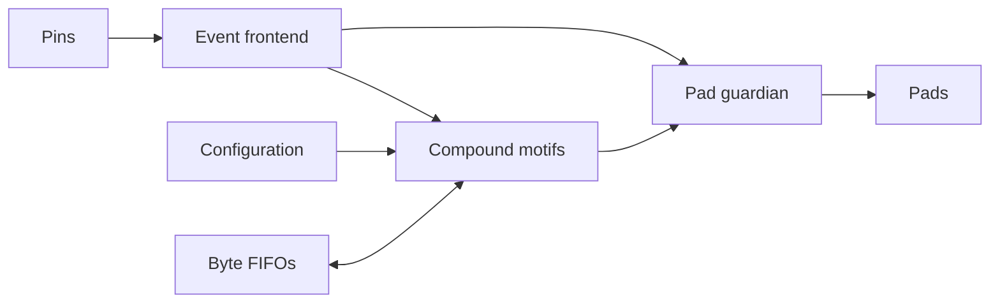

# MOTIF — Protocol Motif Machine

MOTIF explores compound operations for programmable serial I/O. Bounded motifs
combine sampling, shifting, counting, framing, and event generation. An
independent pad guardian controls final output enables.

Current status: initialization. Protocol behavior and implementation results are
published only after their corresponding checks complete.

License: Apache-2.0. See LICENSE.
