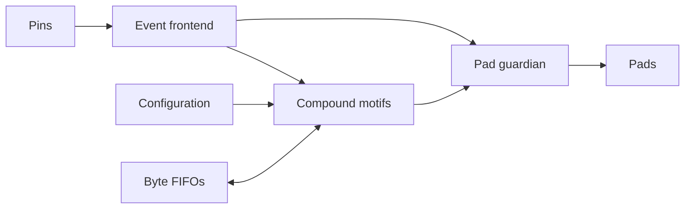

# MOTIF — Protocol Motif Machine

MOTIF explores compound operations for programmable serial I/O. Bounded motifs
combine sampling, shifting, counting, framing, and event generation. An
independent pad guardian controls final output enables.



Current status: SPI mode-0 target, UART 8N1 receive and seven-bit I²C target
behaviors are tested in the executable model. I²C covers repeated START,
ACK/NACK, turnaround, clock stretching and recovery. The SPI/UART RTL subset
matches model traces and accepts runtime host configuration. Guardian formal
properties and synthesis are available. The routed CMOS5L SPI/UART/timed-stream
subset meets the internal 50 MHz timing target and passes layout precheck and
functional gate simulation. I²C remains model-only. See
[physical qualification](docs/physical.md) for measurements and limits.

```sh
python -m pip install -e '.[test]'
python -m pytest -q
python -m tools.rtl_check
python -m tools.formal_check
```

`motif/` contains the model and configuration helpers; `tests/` contains wire-level
and adversarial checks; `docs/` defines behavior and evidence. See
[architecture](docs/architecture.md), [execution semantics](docs/execution-model.md),
[protocol support](docs/protocol-support.md), and [verification](docs/verification.md).
The RTL and host contract are described in [RTL verification](docs/rtl-verification.md)
and [host interface](docs/host-interface.md). Reproduction requires Icarus/VVP for
RTL simulation and Yosys for the formal and synthesis commands.

License: Apache-2.0. See LICENSE.
