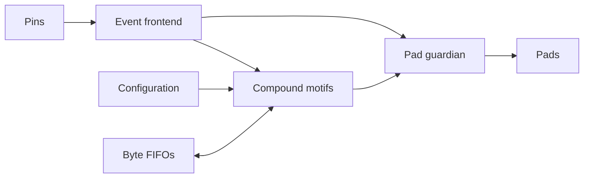

# MOTIF — Protocol Motif Machine

MOTIF explores compound operations for programmable serial I/O. Bounded motifs
combine sampling, shifting, counting, framing, and event generation. An
independent pad guardian controls final output enables.



Current v2 supports SPI mode-0 target, UART 8N1 receive, a framed timed byte
stream, seven-bit I²C target and bounded Microwire 93LC46 x16 READ. The controlled
decomposition preserves all 48 I²C cases and 88,287 legacy comparison cycles;
Microwire returns A55A through the same four generic transaction operations.
The fixed table has sixteen entries; configuration and control storage are
reported separately from the operations.

Frozen v2 passes eight of nine subsequently selected 1-Wire initialization
cases but emits an unwanted presence pulse after interrupted short lows.
Result: `MOTIF_V2_UNSEEN_PROTOCOL_GENERALIZATION_PARTIAL`. The campaign stops
without another semantic repair. The earlier A5FF failure of BYTE_EXCHANGE
remains permanent evidence of its protocol-specific semantics. See the
[decomposition report](experiments/exchange_decomposition/report.md) and
[historical campaign](docs/generalization.md).

V2 model/RTL, runtime host, lint, guardian formal and synthesis checks pass.
V2 has **no routed physical qualification**: the three-protocol gate failed.
Historical CMOS5L results apply to the earlier circuit only. See
[physical qualification](docs/physical.md) for their scope and limits.

```sh
python -m pip install -e '.[test]'
python -m pytest -q
python -m tools.rtl_check
python -m tools.formal_check
```

`motif/` contains the model and configuration helpers; `tests/` contains wire-level
and adversarial checks; `docs/` defines behavior and evidence. See
[architecture](docs/architecture.md), [execution semantics](docs/execution-model.md),
[protocol support](docs/protocol-support.md), and [verification](docs/verification.md).
The RTL and host contract are described in [RTL verification](docs/rtl-verification.md)
and [host interface](docs/host-interface.md). Reproduction requires Icarus/VVP for
RTL simulation and Yosys for the formal and synthesis commands.

License: Apache-2.0. See LICENSE.
