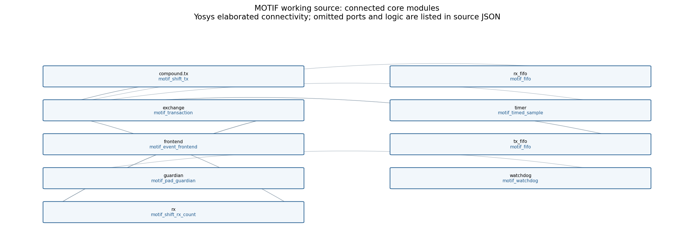

# MOTIF — Protocol Motif Machine

MOTIF explores bounded compound operations for programmable serial I/O. Sampling,
shifting, counting, framing, decisions and responses compose through a fixed
sixteen-entry table. An independent pad guardian controls final output enables.

The **v3 temporal architecture is qualified and frozen**. Its
tagged WAIT responsibility measures continuous synchronized RX levels
or elapsed delays while retaining the existing timed sampler and table format.
Frozen qualification passed 160 tests, 55 temporal fixtures, 18 repaired 1-Wire cases and the original
I²C/Microwire regressions pass. Matched mapped area is 210,241.9746 µm²,
8.1623% above v2, within the fixed 10% cap. The
[immutable freeze](experiments/temporal_qualification/frozen_v3_manifest.json)
precedes independent unseen-workload selection. The selected LIN break/sync
prefix passes all 34 unseen cases over 3,210,266 complete model/RTL cycles,
without changing frozen semantics. The initial pinned physical run ended cancelled
without a published physical archive.
The [first diagnosed revision](https://github.com/wellitsabhinav/MOTIF-Protocol-Motif-Machine/actions/runs/38429471310)
completed routing and generated identified GDS, but failed setup timing at the
fixed 6×4/20 ns target. Its [unqualified physical views](docs/demo/figures/physical/attempt_2/identity.json)
and [negative timing evidence](docs/research/v3_temporal_qualification/physical_attempt_2_diagnosis.md)
are retained. The [final timing-mapping attempt](https://github.com/wellitsabhinav/MOTIF-Protocol-Motif-Machine/actions/runs/38470361703)
at source `5dbf3ab` exceeded the official six-hour execution limit during detailed
routing and published no physical archive. All three permitted attempts are used;
the campaign stops with logical and matched-cost PASS and physical qualification
unestablished. The [final diagnosis](docs/research/v3_temporal_qualification/physical_attempt_3_diagnosis.md)
preserves its explicit cancellation cause and partial observations.
See the
[A–Z campaign report](docs/research/v3_temporal_qualification/final_report.md).

The [verified final HTML package](https://github.com/wellitsabhinav/MOTIF-Protocol-Motif-Machine/actions/runs/38507387085/artifacts/11868951515)
contains all eleven demonstrations, the rendered report and identified physical
evidence. Extract it and open `index.html`.
[Download verification](experiments/temporal_qualification/delivery_final.json)
checks all 524 file hashes and local links.



Run an identified wire-level demonstration and inspect the resulting waveforms:

```sh
python -m pip install -e '.[test]'
python -m pip install matplotlib==3.9.2 Pillow==11.0.0
python -m tools.demo --protocol i2c
python -m tools.demo --all --schematics
```

Open `build/demo/index.html`. The package generates actual RTL waveforms, ordered
executor timelines, configurations, expected/observed results, trace excerpts
and Yosys-derived schematics. It validates model/RTL agreement and returns a
nonzero exit code on a failed check. Reproduction requires Icarus/VVP; schematics
also require Yosys. Full traces and netlists remain ignored build artifacts.
See [getting started](docs/GETTING_STARTED.md) and the
[demonstration guide](docs/demo/README.md).

The bounded profiles cover SPI mode-0 target, UART 8N1 receive, framed timed
stream, seven-bit I²C target and Microwire 93LC46 x16 READ. V3 additionally trains
against the previously selected 1-Wire reset/presence workload. No ROM commands,
data slots, analog compliance or silicon results are established by that test.

Reproduce the selected unseen prefix and its identified demonstrations:

```sh
python -m tools.lin_unseen
python -m tools.lin_host_check
python -m tools.demo --protocol unseen
```

The LIN profile uses a fixed nominal 20 kbit/s digital receive line. Its FIFO
`0x55` token records prefix recognition; it does not implement autobaud,
complete LIN frames or a transmitted LIN response. The
[selection contract](experiments/temporal_qualification/unseen/selected_workload.json)
was committed before configuration. The new CI job publishes full traces;
the local demonstration hook is generated after those traces exist.

Historical evidence stays unchanged. Frozen v2 preserves all 48 I²C cases and
returns Microwire A55A, then passes eight of nine selected 1-Wire initialization
cases. An interrupted short-low sequence incorrectly produces presence:
`MOTIF_V2_UNSEEN_PROTOCOL_GENERALIZATION_PARTIAL`. The earlier BYTE_EXCHANGE
A5FF failure also remains permanent evidence. Read the
[v2 decomposition report](experiments/exchange_decomposition/report.md),
[historical campaign](docs/generalization.md), and
[v3 research records](docs/research/v3_temporal_qualification/).

V2 has no routed physical qualification. Earlier CMOS5L artifacts qualify only
their identified earlier sources. V3 physical work requires an unseen logical
pass after its semantic freeze. That logical gate now passes. Attempt 2 supplies
identified layout previews labeled **UNQUALIFIED**; GDS availability does not
establish timing closure, official precheck or routed functional qualification.
See [historical physical evidence](docs/physical.md) and
[v3 physical reproduction](docs/v3_physical_reproduction.md).

After recreating the unseen traces, package all eleven validated demonstrations
and linked source/evidence for offline browsing:

```sh
python -m tools.v3_delivery --output build/delivery/plain_html
```

Open `build/delivery/plain_html/index.html`. The unseen CI workflow publishes
the same identified HTML package; complete traces and physical outputs remain
separate CI artifacts.

The [verified CI HTML package](https://github.com/wellitsabhinav/MOTIF-Protocol-Motif-Machine/actions/runs/38426446635/artifacts/11829931300)
contains all eleven passing demonstrations and linked public sources. Its
[download verification receipt](experiments/temporal_qualification/delivery_7d3b0a9.json)
binds the archive, manifest, file inventory and resolved HTML links.

```sh
python -m pytest -q
python -m tools.rtl_check
python -m tools.formal_check
```

The model and helpers live in `motif/`, synthesizable sources in `src/`, and
wire-level/adversarial checks in `tests/`. Read
[architecture](docs/architecture.md), [execution semantics](docs/execution-model.md),
[host interface](docs/host-interface.md) and [verification](docs/verification.md)
for exact contracts and limits. The dedicated SPI host loads configurations only
while disabled; RX/TX FIFOs connect the host to the protocol engine.

License: Apache-2.0. See [LICENSE](LICENSE).
