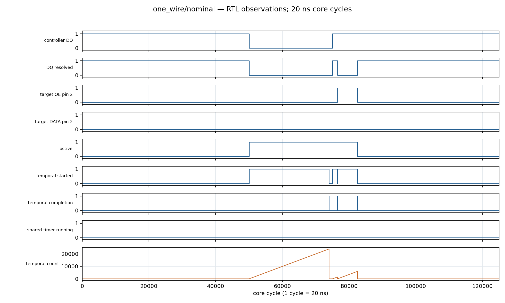
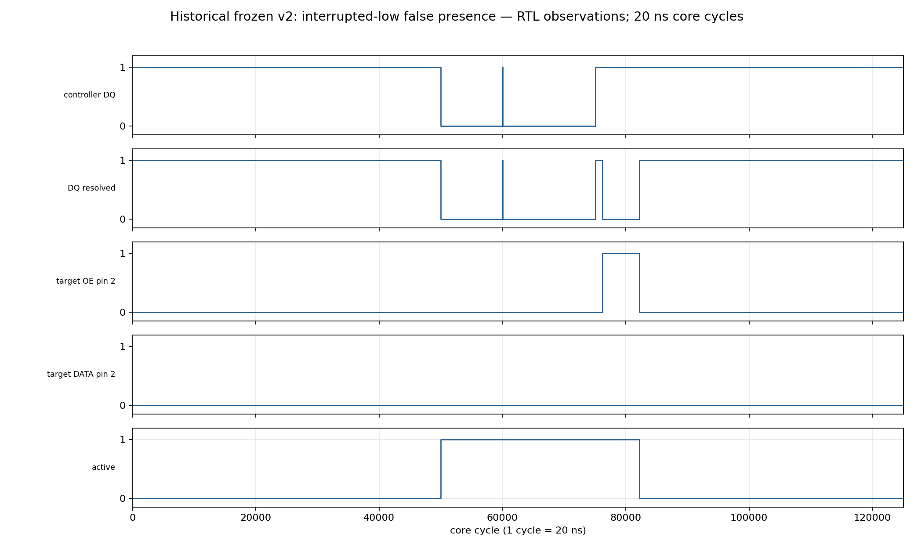

# Reproducible MOTIF demonstrations

`python -m tools.demo --all --schematics` generates `build/demo/index.html` from deterministic simulation. V3 is logically qualified, within its cost limits and frozen. The independently selected LIN prefix passes unseen logical qualification. Physical attempt 2 failed setup timing; identified layout previews are available but physical closure remains unqualified. Demonstration passes establish their recorded bounded behaviors; the campaign classifies each gate separately.

Recreate the selected LIN traces before requesting all eleven reached demonstrations:

```sh
python -m tools.lin_unseen
python -m tools.demo --all --schematics
```

The first command verifies the full 34-case unseen gate and creates its identified local demonstration hook. A clean checkout without that hook runs the seven base demonstrations with `--all`.

| Command selector | Independent expected behavior | Output |
| --- | --- | --- |
| `i2c` | Address/data ACK; receive 55 AA; repeated START; transmit A5 5A; NACK and release | `build/demo/i2c/bounded/` |
| `microwire` | Dummy zero; exact A55A; controller-owned CLK; rising-edge output; separate DI/DO | `build/demo/microwire/bounded/` |
| `one_wire` | One presence after valid reset; none after interrupted 200/1/300 µs low sequence | `build/demo/one_wire/nominal/` and `interrupted_non_reset/` |
| `spi` | Receive 3C; return A6; release on deselection | `build/demo/spi/bounded/` |
| `uart` | Receive 55 A6 in 8N1 frames | `build/demo/uart/bounded/` |
| `timed_stream` | Receive 55 AA under external framing | `build/demo/timed_stream/bounded/` |
| `unseen` | LIN prefix token 55; interrupted false break rejected; fresh-break recovery; two prefixes; all pads released | `build/demo/unseen/{nominal,one_cycle_high_split,pending_sync_recovery,back_to_back}/` |

Every case includes `configuration.json`, `trace_excerpt.json`, `result.json`, `waveform.svg/png`, `timeline.svg/png`, and a case README. Source, stimulus, trace and artifact hashes identify the evidence. `inputs.txt`, `model.jsonl`, `rtl.jsonl`, testbench files and simulation logs retain the complete reproduction. `--reuse` checks all identities before accepting any cached RTL trace.

The selected snapshots in [demonstrations.json](demonstrations.json) record eleven passing demonstrations and 702,987 compared RTL cycles: seven base cases plus four selected LIN cases. Their source identities and recorded scope remain separate from the campaign gates.

| Selected waveform | Actual ordered execution | Configuration and short trace |
| --- | --- | --- |
| [I²C](figures/i2c/bounded/waveform.svg) | [Timeline](figures/i2c/bounded/timeline.svg) | [Configuration](figures/i2c/bounded/configuration.json), [excerpt](figures/i2c/bounded/trace_excerpt.json) |
| [Microwire](figures/microwire/bounded/waveform.svg) | [Timeline](figures/microwire/bounded/timeline.svg) | [Configuration](figures/microwire/bounded/configuration.json), [excerpt](figures/microwire/bounded/trace_excerpt.json) |
| [Valid 1-Wire reset](figures/one_wire/nominal/waveform.svg) | [Timeline](figures/one_wire/nominal/timeline.svg) | [Configuration](figures/one_wire/nominal/configuration.json), [excerpt](figures/one_wire/nominal/trace_excerpt.json) |
| [Interrupted 1-Wire low](figures/one_wire/interrupted_non_reset/waveform.svg) | [Timeline](figures/one_wire/interrupted_non_reset/timeline.svg) | [Configuration](figures/one_wire/interrupted_non_reset/configuration.json), [excerpt](figures/one_wire/interrupted_non_reset/trace_excerpt.json) |
| [SPI](figures/spi/bounded/waveform.svg) | [Timeline](figures/spi/bounded/timeline.svg) | [Configuration](figures/spi/bounded/configuration.json), [excerpt](figures/spi/bounded/trace_excerpt.json) |
| [UART RX](figures/uart/bounded/waveform.svg) | [Timeline](figures/uart/bounded/timeline.svg) | [Configuration](figures/uart/bounded/configuration.json), [excerpt](figures/uart/bounded/trace_excerpt.json) |
| [Timed stream](figures/timed_stream/bounded/waveform.svg) | [Timeline](figures/timed_stream/bounded/timeline.svg) | [Configuration](figures/timed_stream/bounded/configuration.json), [excerpt](figures/timed_stream/bounded/trace_excerpt.json) |
| [LIN nominal prefix](figures/unseen/nominal/waveform.svg) | [Timeline](figures/unseen/nominal/timeline.svg) | [Configuration](figures/unseen/nominal/configuration.json), [excerpt](figures/unseen/nominal/trace_excerpt.json) |
| [LIN interrupted false break](figures/unseen/one_cycle_high_split/waveform.svg) | [Timeline](figures/unseen/one_cycle_high_split/timeline.svg) | [Configuration](figures/unseen/one_cycle_high_split/configuration.json), [excerpt](figures/unseen/one_cycle_high_split/trace_excerpt.json) |
| [LIN fresh-break recovery](figures/unseen/pending_sync_recovery/waveform.svg) | [Timeline](figures/unseen/pending_sync_recovery/timeline.svg) | [Configuration](figures/unseen/pending_sync_recovery/configuration.json), [excerpt](figures/unseen/pending_sync_recovery/trace_excerpt.json) |
| [LIN two prefixes](figures/unseen/back_to_back/waveform.svg) | [Timeline](figures/unseen/back_to_back/timeline.svg) | [Configuration](figures/unseen/back_to_back/configuration.json), [excerpt](figures/unseen/back_to_back/trace_excerpt.json) |





The waveform renderer retains every transition; it does not sample away short pulses. Timeline lanes come directly from the executor’s actual ordered entries. They do not infer execution from the registered PC or configured successors. Source actors without transaction tables show no executed entries.

`--schematics` elaborates the actual source using Yosys, then renders connected module instances and focused program-counter/temporal register logic. Each SVG/PNG is accompanied by a JSON connectivity selection containing the real cell ports and shared net-bit identities. `elaborated.json`, `yosys.log` and `identity.json` identify the full source. These are logic schematics, not physical layout views.

Selected editable figures: [top-level schematic](figures/architecture/top.svg), [core connectivity](figures/architecture/architecture.svg), [transaction control](figures/architecture/transaction.svg), [temporal register](figures/architecture/temporal.svg), and [legacy→v2→v3 module inventories](figures/architecture/evolution.svg). Each connectivity view has a matching JSON file under the same directory. Full elaborated netlists remain reproducible build artifacts.

The historical v2 interrupted-low false presence and earlier BYTE_EXCHANGE A5FF failure remain permanent evidence. The generated HTML embeds the unchanged v2 counterexample and labels it historical. It links the [A–Z campaign report](../research/v3_temporal_qualification/final_report.md). Repaired v3 waveforms use current identified simulation traces.

No unseen workload is researched by this package before the semantic freeze. No physical figure is generated without an identified v3 implementation artifact. If a campaign stop condition prevents later gates, reached demonstrations and an honest report are still deliverables.

Separate [mapped hierarchy](figures/mapped/hierarchy.svg),
[PC bit-0 neighborhood](figures/mapped/transaction_bit0.svg) and
[temporal counter bit-0 neighborhood](figures/mapped/temporal_bit0.svg) derive
from the identified CMOS5L cost netlist. [Their identities](figures/mapped/identity.json)
include source, tool, library and netlist hashes. Run `python docs/demo/render_mapped.py`
after the matched synthesis gate to reproduce them; this renderer does not run
another synthesis or infer missing circuitry. These views establish mapped
connectivity, with omitted logic explicitly listed, rather than physical closure.

The [A–Z campaign report](../research/v3_temporal_qualification/final_report.md)
records logical, cost, unseen and physical outcomes separately.

[Cost graphics](figures/cost/cost_summary.svg) show the actual matched v2/v3
mapped area, mapped cell classes and declared storage with axes starting at zero.
[Editable metrics and identities](figures/cost/cost_summary.json) distinguish the
measured source commits from the receipt checkout. Legacy values without a
comparable pinned receipt remain unavailable. Reproduce this selected view with
`python docs/demo/render_cost.py --receipt-commit 2be40c4 --output-dir build/demo/cost_fresh`.
The renderer reads recorded receipts and does not run synthesis. Physical
measurements, when available from an identified receipt, use a separate figure
and retain their intermediate or final extraction scope.

Attempt 2 supplies actual [floorplan](figures/physical/attempt_2/floorplan.svg),
[placement](figures/physical/attempt_2/placement.png), [routing](figures/physical/attempt_2/routing.png)
and [GDS preview](figures/physical/attempt_2/gds.png), all visibly labeled **UNQUALIFIED**.
Their [identity inventory](figures/physical/attempt_2/identity.json) binds the
actual failed source, workflow and archive. [Physical measurements](figures/physical/attempt_2/physical_cost.svg)
and [three-corner timing](figures/physical/attempt_2/physical_timing.svg) use the
final extracted metrics; official precheck and routed tests were skipped.
Full geometry and dense route vectors stay in the identified CI archive.

The frozen renderer supports a later qualified unseen workload through the [late-input contract](unseen-input-contract.md). Its CLI option appears only when that evaluation supplies an identified result. The interface itself does not select or qualify a workload.

See [getting started](../GETTING_STARTED.md), [execution contract](../execution-model.md), [host interface](../host-interface.md), and [historical campaign](../generalization.md).
