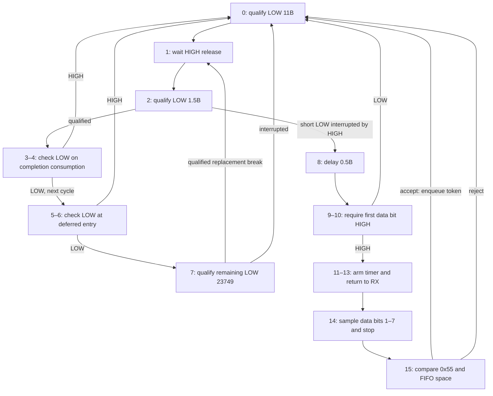

# LIN break/sync prefix configuration

The full gate now passes: all 34 selected cases and 3,210,266 model/RTL cycles,
with unchanged frozen semantics. This is a bounded logical result; physical
qualification remains separate. [Logical receipt](../../../experiments/temporal_qualification/unseen/logical_result.json),
[runtime subset](../../../experiments/temporal_qualification/unseen/runtime_host_result.json),
[independent Linux CI](../../../experiments/temporal_qualification/unseen/ci_result.json).

This document explains the candidate configuration for the selected
`LIN_BREAK_SYNC_ENTRY` experiment. The controlling electrical contract is the
[immutable selection](../../../experiments/temporal_qualification/unseen/selected_workload.json).
The entry graph below describes configuration intent; it is not a qualification
result. A pass requires the independent electrical oracle, complete model/RTL
comparison for all 34 committed cases, and unchanged frozen semantics before
and after evaluation. A model-only run or a successful nominal example does not
establish that gate.

The selection was committed at
`5f67d888df07a7e76f814a8df9984394a951f7ac`, before the configuration was written.
Its LF-normalized SHA-256 is
`f3e6d9b7661d61f07b390f0225deb43eeb03e5819dfd2d2191efc628d1a61663`.
It identifies freeze commit
`638c2ee4e7c9f53c64e6f660331747e5a79b570d` and semantic manifest SHA-256
`71d5b07b5524fb6fa702357291eb35f52eccc5861111f7824b6fb9ead98a3047`.
The selection's `configuration_written: false` records the state at that
selection commit. It is retained as historical evidence, rather than edited
after implementation.

The candidate is generated by
[`candidate()`](../../../tools/lin_unseen.py) and encoded in
[`config.json`](../../../experiments/temporal_qualification/unseen/config.json).
These are post-freeze experiment files. They compose the existing instructions,
shared timer and FIFO; they add no runtime semantics or architectural state.

## Electrical scope and public result

The input is a transceiver-normalized digital receive line on pin 2. Dominant
LOW and recessive HIGH are held on a 50 MHz core grid. One nominal bit period
`B` is 2,500 observations, or 50 microseconds, giving a fixed rate of 20 kbit/s.
The fixtures use a LOW start bit, eight LSB-first data bits and a HIGH stop bit.
All other input pins remain HIGH. No automotive voltage, transceiver, analog
filtering or autobaud behavior is represented.

[LIN Specification Package 2.2A](https://www.lin-cia.org/fileadmin/microsites/lin-cia.org/resources/documents/LIN_2.2A.pdf),
sections 2.3.1–2.3.1.2, printed pages 29–31, distinguishes the master's minimum
13-bit break from the normal receiver's 11-local-bit detector. This experiment
adopts the normal detector, so its threshold is 27,500 consecutive observable
LOW samples. Nominal master breaks are 32,500 samples. A 30,000-sample, 12-bit
LOW is therefore accepted by the chosen receiver detector, while being labeled
nonconforming master generation. The precise-clock 9.5-bit alternative is not
adopted. The legal delimiters in this experiment are 3,000 HIGH observations,
or 60 microseconds; no extra mandatory short-delimiter rejection rule is added.

The recognized public result is an RX FIFO token `0x55`. It means that this
experiment recognized a qualifying break followed by the fixed sync pattern.
It is not a LIN-prescribed response and causes no target transmission. The
independent oracle requires all eight target output-enable bits to remain zero
throughout every trace. It also requires the token to appear no earlier than
the stop-cell beginning and no later than the stop-cell end plus two bit
periods. That finite FIFO latency bound is an experiment criterion, rather than
a protocol response deadline.

The source requires a fresh break/sync sequence to replace an incomplete frame
when a receiver awaits a byte at a separated boundary. The committed cases
therefore include a first break with no sync followed by a fresh break/sync,
and a whole wrong sync followed by a fresh prefix. They do not impose the
optional case of a break superimposed with an already transmitting data byte.
The complete official PDF is an ignored research artifact with SHA-256
`e5e1a4ad3615721c519582914518730e8c49a41b527e82db77e7c3f8b8a18b98`.

## Sixteen-entry graph

All slots are used. Triggers are `ALWAYS` except the timer-triggered receive at
entry 14. `CHAIN` allows an eligible successor to execute in the same cycle,
subject to the frozen four-entry bound and one temporal observation per cycle.
The table names success and rejection targets explicitly; ordinary encoded
alternate operands that are unused by an instruction do not imply another
executed path.

| Entry | Operation and configured operands | Advance or interruption | Chain |
|---:|---|---|:---:|
| 0 | Temporal LOW qualification, threshold 27,500, restart mode | Complete → 1; interruption clears progress and remains at 0 | Yes |
| 1 | Ordinary RX-level WAIT for HIGH release | HIGH → 2; LOW waits | Yes |
| 2 | Temporal LOW qualification, threshold 3,750, branch mode | Complete → 3; interruption after starting → 8; initial HIGH waits | Yes |
| 3 | RX one synchronized bit immediately | Completed field → 4 | Yes |
| 4 | DECIDE that field equals LOW, mask 1, force RX role | Accept → 5; reject → 0 | No |
| 5 | RX one synchronized bit immediately | Completed field → 6 | Yes |
| 6 | DECIDE that field equals LOW, mask 1, force RX role | Accept → 7; reject → 0 | Yes |
| 7 | Temporal LOW qualification, threshold 23,749, branch mode | Complete → 1; interruption after starting → 0 | Yes |
| 8 | Constant-true elapsed delay, threshold 1,250 | Complete → 9 | Yes |
| 9 | RX one synchronized bit immediately | Completed field → 10 | Yes |
| 10 | DECIDE that first sync data bit equals HIGH, mask 1, force RX role | Accept → 11; reject → 0 | No |
| 11 | HANDOFF to TX, load one preloaded `0xFF`, request shared-timer start | Loaded token → 12; absent token is a fatal transaction condition | Yes |
| 12 | RESPOND release | Release → 13 | Yes |
| 13 | HANDOFF to RX | RX handoff takes its alternate → 14 | Yes |
| 14 | RX eight bits from registered shared-timer samples | Eight samples complete → 15 | Yes |
| 15 | DECIDE field equals `0x55`, mask 255, require FIFO space, enqueue on acceptance, force RX role | Accept with space → enqueue and 0; reject → 0 | Yes |

The functional paths are:



## Continuity and the replacement-break boundary

Entry 0 establishes the initial break. The acquisition observation counts as
the first LOW observation when it matches. Any observable HIGH before the
threshold clears that progress. The two-stage frontend shifts the timing of
the held edge-aligned fixtures without combining their distinct LOW intervals.
This is sampled continuity: pulses that the existing frontend cannot observe
remain outside the claim.

After the break is released, entry 2 classifies the next LOW interval. A legal
sync start is one bit long, so the HIGH first data bit interrupts qualification
before the 1.5-bit threshold and selects entry 8. A replacement break remains
LOW past that threshold and must accumulate a full fresh 11-bit interval.
An initially HIGH predicate does not trigger the alternate path, because
branch mode acts only after temporal qualification has started.

The frozen completion is registered and consumed in the following executor
cycle. A later HIGH cannot revoke completion. Entry 3 therefore observes the
LOW predicate again on the cycle consuming entry 2's completion; entry 4
rejects a HIGH on that boundary. Entry 4 has no `CHAIN`, so entry 5 is reached
on the next cycle. Entries 5 and 6 check LOW before entry 7 can begin. This
second guard prevents an initially false second temporal entry from waiting
and later combining a fresh interval with the first phase's stale progress.

For an uninterrupted replacement break, number its first LOW observation zero.
Entry 2 counts observations 0 through 3,749, entry 3 checks observation 3,750,
and entry 7 counts observations 3,751 through 27,499. Entry 5's guard shares
observation 3,751 with entry 7's first count; it adds no second count. The full
interval is thus:

```text
3750 first-phase observations + 1 guarded completion observation
    + 23749 second-phase observations = 27500 consecutive LOW observations
```

The second temporal operation is deferred when reached in a cycle that already
executed the first. These guards preserve the intended continuity across that
deferral and registered-completion boundary. They are configuration-level
checks using the existing RX and DECIDE operations.

## Fixed sync recognition and timer arming

The first HIGH after the one-bit start branches to entry 8. Its 1,250-observation
delay places the immediate sample at entry 9 near the first data-bit center.
Entry 10 requires HIGH. Consequently, a one-core-cycle HIGH pulse in the first
data cell of `0x54` cannot alone satisfy the later first-bit check when the
center remains LOW.

Entries 11–13 then request a restart of the existing shared sampler and return
to RX. Entry 14 receives seven remaining data bits and the stop bit at the
configured 2,500-cycle period. For wire sync `0x55`, those observations are
`0, 1, 0, 1, 0, 1, 0, 1`; the last HIGH is the stop sample. The existing field
shifter is configured MSB-first, so this particular sequence forms the field
`0x55` checked at entry 15. The first data bit was checked separately. This
fixed-pattern construction does not claim a general LSB-first UART payload
decoder. The independent oracle derives expected bytes from the input schedule
at nominal bit centers and checks public token timing. It does not inspect the
internal timer's sampling position. Constant bit cells allow small executor
and registered-timer offsets; the candidate must still produce the independently
expected value within the public acceptance window.

Timer arming uses the existing TX handoff operation, which requires TX
permission and a FIFO token. The fixture preloads at most four constant
`0xFF` bytes before controller traffic. Pin 3 is a separate, unused open-drain
TX pin (`open_drain = 8`); it does not alias the LIN receive pin. Loading
`0xFF` selects released HIGH, and the same chain explicitly releases the
response and hands ownership back to RX. The intended external behavior is
zero output enable on every pin. The oracle checks that condition from public
simulation outputs, including these timer-arming cycles. There are no host
timing commands, configuration writes or FIFO reads during controller traffic.

After either a completed match or a rejected field, entry 15 returns to the
fresh LOW scanner at entry 0. A wrong sync does not leave a reusable accepted
header. A later `0x55` without a new qualifying break must therefore remain
unaccepted. The ordinary sample timer may run while qualification waits;
entry 14 is the only configured operation that consumes its sample events.

## Qualification and stopping rules

[`tools.lin_unseen`](../../../tools/lin_unseen.py) creates the committed 25 named
cases and nine legal break-length/phase combinations. Its independent
[`lin_oracle`](../../../tools/lin_oracle.py) uses resolved receive-line samples,
lifecycle inputs, public FIFO observations, external reads and target output
enables. It does not read the configuration graph, executor PC, qualification
state, timer state or MOTIF decoder to derive expected tokens. Posttraffic
reads follow a 5,000-cycle HIGH margin and use pre-edge public FIFO state.
Missing, wrong, early, duplicate or extra tokens fail the gate.

The required command is `python -m tools.lin_unseen`. Its `--model-only` and
`--case` options are diagnostics and do not establish complete qualification.
The full gate must compare all 34 cases against frozen RTL and fail with a
nonzero exit status if required validation fails. Attempt identities and
configuration snapshots belong with the evidence; the source selection and
oracle contract remain unchanged across permitted configuration revisions.

The separate [host runtime test](../../../test/lin_runtime.py), run by
`python -m tools.lin_host_check`, exercises four selected cases: nominal,
one-cycle HIGH interruption, pending-sync recovery and back-to-back prefixes.
It resets the top-level device for each case, checks interface version 3, loads
the table and configuration through the actual host interface, preloads four
`0xFF` bytes and enables execution. During controller traffic, it changes only
the receive-line stimulus and checks the public pad output-enable mask at each
driver callback. After 5,001 HIGH cycles, it checks RX FIFO occupancy, reads
the independently expected tokens through host register 17, confirms empty
occupancy and checks the public fault register.

That runtime test establishes host loading and posttraffic public FIFO behavior
for its four cases. Its per-cycle output-enable check is active during the
controller-traffic callbacks, with a further check after the HIGH margin; it
does not record every output-enable cycle during the margin or host drain.
It also does not densely observe FIFO occupancy during traffic, so it cannot
independently establish the early-token acceptance window. Those complete
core-cycle FIFO timing and output-enable checks remain responsibilities of
the full 34-case differential/electrical gate. Neither runtime subset success
nor routed-netlist execution of that subset replaces the complete logical
qualification requirement or establishes physical timing closure.

No result is claimed here without its qualification receipt. If a failing
case requires modifying frozen model or RTL semantics, frontend or timer
behavior, instruction vocabulary or architectural state, the counterexample
must be preserved and this campaign stops. Oracle weakening and candidate
substitution are prohibited. Physical work is permitted only after a complete
unseen logical pass. Even that pass would establish only this fixed-rate
digital prefix experiment: PID, data, checksum, full LIN frames, autobaud,
analog compliance and physical timing closure remain separate claims.
